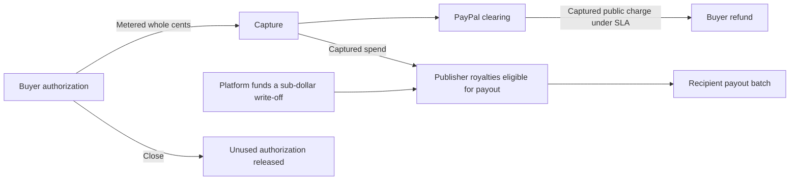
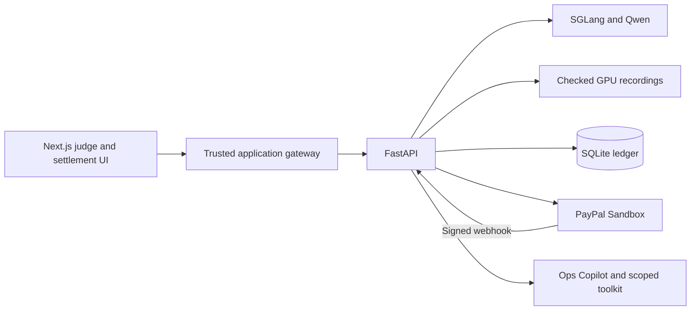

# Cachet

Cachet lets coding agents buy warm open-source context. The engine counts reused tokens, the ledger attributes royalties to publishers, and PayPal Sandbox handles the money.


On this turn the engine reused 25,913 of 26,260 input tokens. The inspector attributes 11,992 hits to Starlette and 13,908 to FastAPI. The remaining 13 hits belong to the system prefix. [Recorded turn and token ranges](backend/app/replay/traces/rate-limit-buy.json)

## The problem and who it affects

A team running coding agents may repeatedly process the same framework across unrelated sessions. A hot prefix avoids much of this prefill work. Cache lifetimes depend on the provider and cache configuration. Cachet uses observed reuse to price each turn and credit the maintainers who supplied the shared code. [Claude prompt caching](https://platform.claude.com/docs/en/build-with-claude/prompt-caching)

## From a prompt to a payout

1. A publisher selects pinned Starlette or FastAPI source. The gateway checks its hash, tokenizes it, warms the prefix, and probes again. The catalog shows the measured hit ratio.
2. The buyer sets a budget and approves a sandbox order. The agent compares the cost of sharing the hot prefix with a private compute baseline before its ten-turn task.
3. SGLang returns cumulative cached input tokens. Intersecting that prefix with each source span gives the exact hits attributed to each layer. A tenant salt separates private turns.
4. Each turn posts integer microdollars to a double-entry ledger. Captures batch whole cents. An SLA audit reverses uncaptured charges or requests a PayPal refund for captured charges. Payouts group royalties by recipient. Reconciliation reads back the corresponding PayPal objects.



A mandate is Cachet’s spending cap backed by one sandbox authorization. It follows `CREATED → APPROVED → AUTHORIZED → ACTIVE`. Each capture passes through `CAPTURING` and the agent can use the remaining authorization on later tasks. A run stops after ten idle minutes. The mandate stays available for up to 72 hours, subject to its cap, provider state and explicit close. Closing moves through `CLOSING`, settles eligible charges and releases the remaining authorization. Terminal states include `CLOSED`, `VOIDED`, `EXPIRED` and `FAILED`. [State transitions](backend/app/settlement/mandate_fsm.py) · [Capture and close](backend/app/settlement/service.py)

## Pricing, fees and forgiveness

At the default tariff, a private input miss costs $1.00 per million tokens and a private hit costs $0.10. A shared hit costs $0.15, including $0.04 for the publisher pool on publisher-owned tokens. A missed shared token is free. Generated output costs $2.00 per million tokens. The quote's private price per million is `f × 1.00 + (1 − f) × 0.10`, where the user sets the expected cold fraction `f`. At 25% the private estimate is $0.325 per million. The quote assumes the selected shared prefix will hit. Actual billing uses the metered result of each turn. [Pricing, attribution and verification](docs/pricing.md)

The gateway stops before a turn if its spending estimate exceeds the available cap. Across tasks, accrued charges trigger a whole-cent capture at $2.00. At close, a balance of at least $1.00 is eligible for a final capture. Cachet writes off smaller balances against the platform, preserving eligible publisher royalties. PayPal releases the portion of the authorization it did not capture. A warm SLA breach reverses the eligible public charge and associated royalties. A captured portion can produce a provider refund. Each publisher receives whole cents once funded payables reach $0.25 in an ordinary workspace or $0.01 in Judge Mode. Fractional amounts remain on the ledger. [Settlement policies and account measurements](docs/pricing.md)

| Observed operation in one US sandbox merchant account | Gross | Actual PayPal fee | Outcome |
|---|---:|---:|---|
| Small capture | $0.50 | $0.50 | $0.00 net |
| Accumulated capture | $2.00 | $0.54 | $1.46 net |
| Final capture on the same $5 mandate | $1.03 | $0.52 | $0.51 net and $1.97 released |
| Two payout items | $0.10 and $0.20 | $0.25 each | Both recipient items succeeded |

The capture dialog estimates $0.55 on $2.00 under the observed fee estimate of 2.99% plus $0.49, capped at the capture amount. It displays PayPal’s actual fee and net after capture. The measured fees apply to these sandbox transactions. [Sandbox GET measurements](docs/pricing.md)

## Architecture and inference modes



In **Live**, the gateway sends requests to the registered SGLang engine. Its GPU agent announces the current HTTPS origin immediately on a change and sends a heartbeat every 30 seconds. The API probes that origin and accepts a heartbeat younger than 90 seconds. **Hosted fallback** requires a separately provisioned, calibrated native SGLang service. **Replay** serves two built-in tasks at their archived quote settings. A run retains its selected mode, and every metered turn records it. Financial operations in all three modes use the configured sandbox. [GPU registration and network-path calibration](docs/inference-registration.md) · [Deployment](docs/deployment.md)

## PayPal APIs

| API or SDK | Use in Cachet | Caller |
|---|---|---|
| OAuth 2.0 | Obtain a sandbox access token for backend operations | [PayPal client](backend/app/paypal/client.py) |
| JavaScript SDK | Wallet button and buyer approval | [Wallet](frontend/components/wallet.tsx) |
| Orders v2 | Create an order with AUTHORIZE intent, read it and authorize the approved budget | [Settlement service](backend/app/settlement/service.py) |
| Payments v2, authorizations | Capture, including final capture, or void an unused authorization | [Settlement service](backend/app/settlement/service.py) |
| Payments v2, captures and refunds | Refund captured public charges after a measured SLA breach and read back the refund | [Audit](backend/app/settlement/audit.py) · [PayPal client](backend/app/paypal/client.py) |
| Payouts v1 | Send one batch with separate recipient items, then read individual statuses and fees | [Payout job](backend/app/settlement/payout_job.py) |
| Webhooks and Notifications | Register events, verify incoming signatures and process redeliveries idempotently | [Registration](scripts/register_webhooks.py) · [Receiver](backend/app/api/webhooks.py) |
| Transaction Search and PayPal Agent Toolkit | Look up workspace-owned order details and reporting history in Ops Copilot. Object GETs are the reconciliation source when sandbox reporting lags | [Toolkit adapter](backend/app/paypal/toolkit.py) · [Reconciliation](backend/app/paypal/reconciliation.py) |

## AI components

| Component | Model or service | Role |
|---|---|---|
| Coding agent | Qwen2.5-7B-Instruct-AWQ | Uses its previous outputs to investigate a framework task over ten turns. [Agent](backend/app/agents/inference.py) |
| Inference gateway | SGLang | Streams text and reports cached input tokens for tenant-scoped prefixes. [Gateway](backend/app/gateway/sglang_client.py) |
| Quote explanation | Qwen via SGLang | Explains the deterministic buy/compute decision in a separate platform-funded request. [Checked explanations](backend/app/replay/quote_reasons.json) |
| Anomaly check | Deterministic ledger rules and seven-day volume statistics | Suppresses identifiable same-payer royalties and surfaces unusual daily use for review. [Detection](backend/app/agents/anomaly.py) |
| Recorded inference | Archived Qwen conversations | Checks hashes, source revisions and the original quote before replaying a conversation. [Recorder](scripts/record_sessions.py) |
| Ops Copilot | Local model or configured OpenAI-compatible endpoint | Uses workspace-scoped tools to answer payment and royalty questions. A human confirms refund proposals. [Copilot](backend/app/agents/copilot.py) |

The quote determines whether the agent buys shared context or computes privately. Before the first metered turn, the serving model explains the choice in a separate, unbilled request. Cachet checks both prices and the selected strategy before publishing the explanation. The archive pairs each original quote with a separately recorded explanation and preserves the original coding responses. With SGLang online, run `.venv/bin/python -m scripts.record_quote_reasons --verify-only` to reconstruct the four input token sequences. [GPU quote recordings](backend/app/replay/quote_reasons.json)

The AG Studio settlement dashboard exposes the ledger, the custom Prefix Royalty Tree and Ops Copilot. A human confirms a proposed refund before execution. [Settlement dashboard](frontend/studio/settlement.tsx)

## Benchmarks

The benchmark used Qwen2.5-7B-Instruct-AWQ, SGLang 0.5.23 and an NVIDIA GeForce RTX 3090 Ti with 24 GiB of VRAM. This baseline used five cold/warm pairs per length on the GPU host. Time to first text includes the local HTTP transport and detokenization.


| Prefix tokens | Cold p50 | Warm p50 | Local warm SLA |
|---:|---:|---:|---:|
| 2,000 | 382.9 ms | 28.0 ms | 56.0 ms |
| 4,000 | 783.1 ms | 28.0 ms | 56.0 ms |
| 8,000 | 1,737.3 ms | 29.1 ms | 58.2 ms |
| 16,000 | 4,143.1 ms | 47.2 ms | 94.4 ms |
| 26,000 | 8,258.4 ms | 69.3 ms | 138.7 ms |

The fitted native prefill cost is `C(n) = αn + βn²`, with α = 0.169910 ms/token and β = 0.00000566936 ms/token². Live quotes and SLA checks on the deployed API use its separately measured route to the GPU. [GPU-host measurements and fit](bench/results/calibration.json)

A separate ten-turn FastAPI rate-limiting task produced its first text in 186 ms using the shared prefix and 8,277 ms computing privately. Pricing each independent conversation's actual token counts at the default tariff gives $0.045621 and $0.056174 respectively, before any SLA adjustments. Two of those ten shared calls met the 138.152 ms warm SLA in effect for that recording. Those two calls accounted for 1,390 microdollars of Starlette royalties and 682 microdollars of FastAPI royalties at the default tariff. The two conversations produced their own outputs. These amounts describe metered usage. The shared FastAPI answer included prose around its working module.

All four final generated modules passed the isolated HTTP checks. For both Starlette strategies, `/ping` returned JSON with `X-Route-Class: custom`, an unknown URL returned 404, and a second endpoint inherited the same header from the route subclass. Both FastAPI modules enforced independent client quotas and restored access after 60 seconds. [Paired benchmark and fit](bench/results/calibration.json) · [Session comparison](bench/results/sessions.json)

## Prior work

| Project or study | What it measures or allocates | What the result is used for |
|---|---|---|
| thanks.dev | Dependencies declared in a sponsor’s repositories | Divides a donation among the upstream projects the sponsor uses. [Canonical’s funding example](https://canonical.com/blog/canonical-thanks-dev-giving-back-to-open-source-developers) |
| Langfuse | Per-call token usage, including provider-reported cached tokens, with a price for each usage type | Reports application spend by model, user or tag. [Usage and cost tracking](https://langfuse.com/docs/observability/features/token-and-cost-tracking) |
| *Can I Buy Your KV Cache?* | The compute cost of reusing a document’s KV cache versus rebuilding it | Proposes provider-hosted reuse and identifies payment between publishers and consumers as an open problem. [Zhang, 2026](https://arxiv.org/abs/2606.13361) |
| Cachet | The intersection of an engine-reported cache hit with each publisher’s token range on a specific turn | Calculates each publisher’s royalty and records it in the ledger. The settlement implementation batches funded royalties for PayPal Sandbox payout. [Attribution and settlement](docs/pricing.md) |

## Judge Mode and test credentials

Open `/judge` in a configured deployment and choose **Start guided demo**. Each judge receives an isolated workspace. Follow the six steps in order.

1. **Workspace** publishes the two licensed layers and checks their measured heat. Separate operator-funded sandbox tasks prepare enough royalties for both recipients. Preparation can take several tasks. Its usage, captures and waived amount remain visible.
2. **Mandate** shows the dedicated **sandbox buyer email and password**. Copy them into the PayPal sandbox wallet to approve the suggested $5 cap, or use the configured sandbox test card. No personal PayPal account or AI key is needed on a configured site.
3. **Agent task** compares shared and private quotes, then streams ten measured coding turns. Open a turn for its token ranges, time to first text and charge.
4. **Capture now** previews the fee on the accrued whole cents. Confirm to see the actual PayPal capture, fee and net.
5. **Fault and refund** starts three additional delayed calls on the same mandate, captures their eligible portions and audits the measured breaches. Inspect the linked refund.
6. **Close and settle** shows any final capture or write-off, the released authorization, both payout items and reconciliation against PayPal.

**Dedicated PayPal Sandbox Demo Buyer**

- Email `sb-vfro4353809961@personal.example.com`
- Password `1H>Qo^kR`

On a local wallet test, ten unique measured turns survived a real browser stream disconnect. The browser resumed from event 4 and received event 5. Closing the $1 authorization released the full dollar and the platform waived $0.035196. In a separate six-step sandbox test, the judge captured $0.06 and released $0.94. The two recipients received $0.02 and $0.01 after the separate preparation. [Judge controls](frontend/components/judge.tsx)

## Run locally

Install Docker with the Compose plugin and OpenSSL. The two containers can serve archived runs without a GPU or PayPal credentials. On a clean Linux checkout at `abd56bb`, a fresh BuildKit builder built both images and brought up seven working pages in 104.79 seconds. Replacing both containers preserved the workspace in the named SQLite volume. From a fresh checkout, generate two independent local secrets and start the services. The SQLite ledger persists in the `ledger` volume.

```sh
test -f .env || (
  umask 077
  printf 'ADMIN_TOKEN=%s\nBFF_TOKEN=%s\n' "$(openssl rand -hex 32)" "$(openssl rand -hex 32)" > .env
)
docker compose up --build -d
```

Open the [local application](http://127.0.0.1:3000) and [the UI gallery](http://127.0.0.1:3000/dev/ui) to inspect the four archived coding runs. The mode badge reports replay. The API and the browser gateway bind to loopback. Set `CACHET_WEB_PORT` and `CACHET_API_PORT` before bringing the project up if those ports are already in use. Run `docker compose down` to stop it and retain the ledger.

For real sandbox payments, add your own sandbox application, recipient and buyer settings from [.env.example](.env.example) to the same file and recreate the services. Real PayPal authorization is required to spend a budget in either inference mode. To use your GPU, set `CACHET_COMPOSE_GPU_URL` to the SGLang endpoint reachable from the API container and `CACHET_COMPOSE_GPU_KEY` to that engine's token. Restart the API and verify that [its health response](http://127.0.0.1:8000/api/health) reports `live`.

For native development, use Python 3.11, Node.js 22, npm, Make and tmux.

```sh
make setup
make dev
```

Open [the judge guide](http://127.0.0.1:3000/judge). Choose **Start guided demo** to create an isolated workspace. The catalog and settlement pages show the records in the current workspace. Keys belong in the private project `.env`. Setup generates a gateway token, keeps existing configuration and creates the local database on first startup. The API is available at [loopback health](http://127.0.0.1:8000/api/health).

For sandbox transactions, configure a PayPal sandbox app with Payouts access, a demo sandbox buyer, and two distinct sandbox receiver accounts. Set the `PAYPAL_*`, `JUDGE_BUYER_*` and `PUBLISHER_*_EMAIL` fields in `.env`. Judge mode then displays the configured sandbox buyer during checkout. Only set the optional fixed test-card fields for a supported sandbox card. Ordinary workspaces supply their own receivers. The two sandbox publishers in the walkthrough are test roles using licensed framework excerpts. PayPal Sandbox issues the authorization and payment receipts.

For live inference on Linux, use a compatible NVIDIA GPU, CUDA toolkit and `uv`. Generate a separate random `SGLANG_API_KEY` in the project `.env`, install the pinned model and start the authenticated tmux service:

```sh
scripts/start_sglang.sh --install
scripts/start_sglang.sh
```

For Ops Copilot's PayPal read tools, run `.venv/bin/python scripts/toolkit_probe.py install`. The toolkit runs in a separate Python environment. Copilot uses the local model, or the configured OpenAI-compatible endpoint. Transaction history is visible only for provider IDs in the current workspace. Sandbox Reporting can lag behind the Payments API. Sandbox Copilot exposes order lookup and transaction search. The Toolkit merchant-insights endpoint requires a supported merchant environment.

## Tests

```sh
make test
make verify
make verify-full
make e2e
```

`make verify` runs unit and non-PayPal integration tests. With a configured GPU it includes real generation, cache flushes and tenant isolation. Run it with exclusive access to that inference server. `make verify-full` also requires sandbox credentials and provisioned accounts.

`make e2e` uses one judge workspace and real sandbox payments. If either publisher is below the payout minimum, the driver first runs paid ten-turn framework questions on the GPU to earn eligible royalties. These preparation sessions follow the same SLA, refunds and hourly limits as any other run. Their charges and balances are recorded separately; only the three built-in coding sessions with fault injection, refunds, two payouts and successful reconciliation count toward acceptance. See [the sandbox sequence and acceptance instructions](docs/pricing.md).

To reproduce the five-band benchmark use `.venv-sglang/bin/python -m bench.calibrate`. Local charts and checked-in traces do not require GPU installation to inspect.

With Docker running, verify the actual final modules over loopback HTTP inside network-isolated containers:

```sh
.venv/bin/python -m scripts.check_generated_apps --build --require-passed
```

## Limitations and fallbacks

A fresh Compose deployment can display archived results without credentials. Funding, capture, refund and payout require actual PayPal Sandbox accounts. Free-text coding tasks require a live model. Replay accepts the recorded tasks and quote inputs (25% cold for buy, 0% for compute), and explicitly identifies their original model output. A verified independent hosted engine and its calibration must be provisioned before that mode can serve calls. [Supported modes](docs/deployment.md)

Cachet measures time to first text over the selected route. Network latency affects that measurement. Calibrate a public API’s actual path to its GPU before comparing a live turn with its SLA. Sandbox Transaction Search can lag, and a confirmed payout batch still requires successful individual payee items. Current measurements describe the tested GPU and sandbox account. [Calibration](docs/inference-registration.md) · [Settlement details](docs/pricing.md)

## License and third-party notices

Original Cachet code uses the MIT license. The source excerpts, model, UI libraries and other dependencies retain their upstream licenses. The two publishers in the demo are sandbox test roles. [MIT license](LICENSE) · [Third-party notices](THIRD_PARTY_NOTICES.md)
