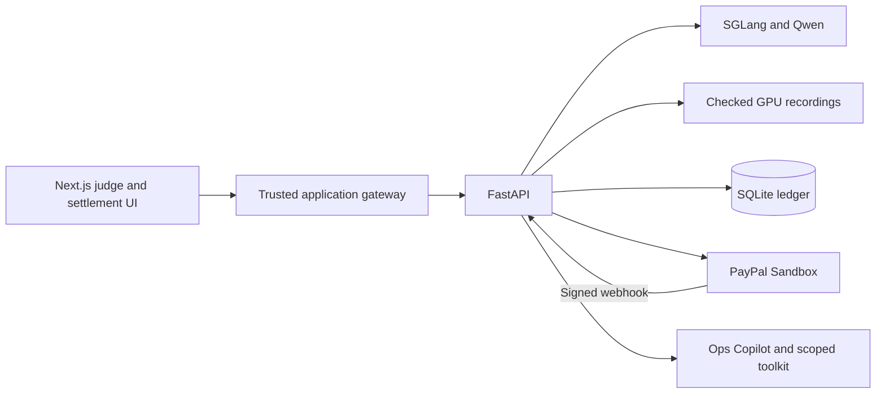
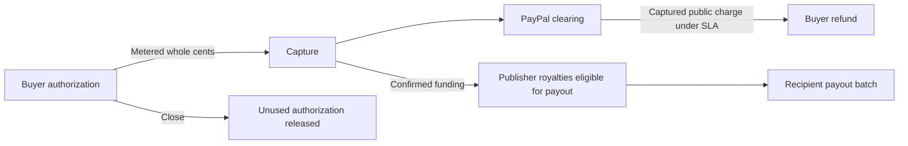

# Cachet

Cachet lets coding agents buy warm open-source context. The engine counts reused tokens, the ledger attributes royalties to publishers, and PayPal Sandbox handles the money.


A team running coding agents may repeatedly process the same framework across unrelated sessions. A hot prefix avoids much of this prefill work. Cache lifetimes depend on the provider and cache configuration. Cachet uses observed reuse to price each turn and credit the maintainers who supplied the shared code. [Claude prompt caching](https://platform.claude.com/docs/en/build-with-claude/prompt-caching)

## Try it locally

Use Python 3.11, Node.js 22, npm, Make and tmux. A fresh checkout can serve the UI, SQLite ledger, measured benchmarks and recorded workloads without a GPU.

```sh
make setup
make dev
```

Open [the judge guide](http://127.0.0.1:3000/judge). Choose **Start guided demo** to create an isolated workspace. The catalog and settlement pages show the records in the current workspace. Keys belong in the private project `.env`. Setup generates a gateway token, keeps existing configuration and creates the local database on first startup. The API is available at [loopback health](http://127.0.0.1:8000/api/health).

For sandbox transactions, configure a PayPal sandbox app with Payouts access, a demo sandbox buyer, and two distinct sandbox receiver accounts. Set the `PAYPAL_*`, `JUDGE_BUYER_*` and `PUBLISHER_*_EMAIL` fields in `.env`. Judge mode then displays the configured sandbox buyer during checkout. Only set the optional fixed test-card fields for a supported sandbox card. Ordinary workspaces supply their own receivers. The two sandbox publishers in the walkthrough are test roles using licensed framework excerpts. A PayPal login, mandate ID or payment receipt is never generated locally.

For live inference on Linux, use a compatible NVIDIA GPU, CUDA toolkit and `uv`. Generate a separate random `SGLANG_API_KEY` in the project `.env`, install the pinned model and start the authenticated tmux service:

```sh
scripts/start_sglang.sh --install
scripts/start_sglang.sh
```

For Ops Copilot's PayPal read tools, run `.venv/bin/python scripts/toolkit_probe.py install`. The toolkit runs in a separate Python environment. Copilot uses the local model, or the configured OpenAI-compatible endpoint. Transaction history is visible only for provider IDs in the current workspace. Sandbox Reporting can lag behind the Payments API. Sandbox Copilot exposes order lookup and transaction search. The Toolkit merchant-insights endpoint requires a supported merchant environment.

## From a prompt to a payout

1. A publisher selects pinned Starlette or FastAPI source. The gateway checks its hash, tokenizes it, warms the prefix, and probes again. The catalog shows the measured hit ratio.
2. The buyer sets a budget and approves a sandbox order. The agent compares the cost of sharing the hot prefix with a private compute baseline before its ten-turn task.
3. SGLang returns cumulative cached input tokens. Intersecting that prefix with each source span gives the exact hits attributed to each layer. A tenant salt separates private turns.
4. Each turn posts integer microdollars to a double-entry ledger. Captures batch whole cents. An SLA audit reverses uncaptured charges or requests a PayPal refund for captured charges. Payouts group royalties by recipient. Reconciliation reads back the corresponding PayPal objects.





The normal mandate path is `CREATED → APPROVED → AUTHORIZED → ACTIVE`. A partial capture moves through `CAPTURING`. Closing performs the final whole-cent capture when due, checks the provider authorization, releases the remainder and journals rounding dust. The state machine also handles void, expiry and failure. [State machine](backend/app/settlement/mandate_fsm.py) · [Settlement service](backend/app/settlement/service.py)

## Pricing and performance

At the default tariff, a private input miss costs $1.00 per million tokens and a private hit costs $0.10. A shared hit costs $0.15, including $0.04 for the publisher pool on publisher-owned tokens. A missed shared token is free. Generated output costs $2.00 per million tokens. The quote's private price per million is `f × 1.00 + (1 − f) × 0.10`, where the user sets the expected cold fraction `f`. At 25% the private estimate is $0.325 per million. The quote assumes the selected shared prefix will hit. Actual billing uses the metered result of each turn. [Pricing, attribution and verification](docs/pricing.md)

The benchmark used Qwen2.5-7B-Instruct-AWQ, SGLang 0.5.23 and an NVIDIA GeForce RTX 3090 Ti with 24 GiB of VRAM. Each prefix length has five cold/warm pairs. Time to first text includes the local HTTP transport and detokenization.

| Prefix tokens | Cold p50 | Warm p50 |
|---:|---:|---:|
| 2,000 | 384 ms | 28 ms |
| 4,000 | 783 ms | 28 ms |
| 8,000 | 1,743 ms | 29 ms |
| 16,000 | 4,160 ms | 47 ms |
| 26,000 | 8,432 ms | 69 ms |

A separate ten-turn FastAPI rate-limiting task produced its first text in 97 ms using the shared prefix and 8,241 ms computing privately. Pricing each independent conversation's actual token counts at the default tariff gives $0.043542 and $0.053966 respectively. The two conversations produced their own outputs. These amounts describe metered usage. [Paired benchmark and fit](bench/results/calibration.json) · [Session comparison](bench/results/sessions.json)

## Inference and settlement components

| Component | Responsibility | Implementation |
|---|---|---|
| Qwen coding agent | Uses its previous outputs to investigate a real framework task over ten turns | [Agent](backend/app/agents/inference.py) |
| SGLang | Streams text and reports exact cached tokens against tenant-scoped prefixes | [Gateway](backend/app/gateway/sglang_client.py) |
| Replay | Checks hashes, source revisions and the original quote for one of four recorded conversations | [Recorder](scripts/record_sessions.py) |
| Ops Copilot | Uses workspace-scoped tools for payment and royalty questions. A human confirms refund proposals | [Copilot](backend/app/agents/copilot.py) |
| AG Studio | Shows real workspace journals, a custom royalty tree, theme and Copilot agent | [Dashboard](frontend/studio/settlement.tsx) |
| PayPal JS SDK and Orders v2 | Browser approval and an AUTHORIZE order for the budget | [Wallet](frontend/components/wallet.tsx) · [PayPal client](backend/app/paypal/client.py) |
| Payments v2 | Capture authorized spend, release the unused budget and refund eligible captures | [Settlement service](backend/app/settlement/service.py) |
| Payouts v1 | Group recipient items into a durable payout batch and read back fees and statuses | [Payout job](backend/app/settlement/payout_job.py) |
| Webhooks and Reporting | Verify signatures, process events and inspect transaction history with the PayPal Agent Toolkit | [Webhook handler](backend/app/api/webhooks.py) · [Toolkit](backend/app/paypal/toolkit.py) |

The mode badge reflects the reachable engine. With the GPU offline, recorded mode supports the two built-in tasks and their original quote inputs (25% cold for buy and 0% for compute). Every replay turn carries its mode. Free-text tasks need live inference. Payments in either mode require the configured PayPal sandbox.

## Verification

```sh
make test
make verify
make verify-full
make e2e
```

`make verify` runs unit and non-PayPal integration tests. With a configured GPU it includes real generation, cache flushes and tenant isolation. `make verify-full` also requires sandbox credentials and provisioned accounts. `make e2e` uses real provider operations in a dedicated judge workspace. See [the sandbox sequence and acceptance instructions](docs/pricing.md). To reproduce the five-band benchmark use `.venv-sglang/bin/python -m bench.calibrate`. Local charts and checked-in traces do not require GPU installation to inspect.

## Prior work and scope

The paper *Can I Buy Your KV Cache?* shows why provider-side prefix reuse can be economical and identifies cross-party payment as an open problem. Cachet meters contributions within a running inference engine and connects that usage to a spending authorization and publisher payables. Dependency funding platforms such as thanks.dev address a related maintainer-funding problem. [Paper](https://arxiv.org/abs/2606.13361) · [thanks.dev](https://thanks.dev/)

The checked-in evidence covers the GPU benchmark, forty recorded turns, local ledger checks and browser integration. Sandbox receipt totals, payout throughput and publicly hosted uptime require a provisioned deployment. Fees come from actual provider responses. The Render configuration uses a single API process and a persistent SQLite disk. [Deployment](docs/deployment.md)

Original Cachet code is released under the MIT license. Redistributed source excerpts and the model retain their respective licenses. [MIT](LICENSE) · [Third-party notices](THIRD_PARTY_NOTICES.md)
